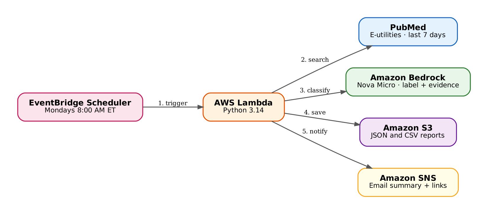

# 💊 AI Drug Side Effect Tracker

An educational AWS lab that automates a weekly PubMed literature search for skin reactions to **topical fluorouracil 5% cream (Efudex)**.

Every Monday, the tracker:

1. 🔎 Searches PubMed for articles added in the last 7 days.
2. 🧠 Uses Amazon Bedrock (Nova Micro) to classify each abstract by severity, with an exact quote from the abstract as evidence.
3. 🗂️ Saves JSON and CSV reports to Amazon S3.
4. 📧 Emails a summary through Amazon SNS, with a link to every article for manual verification.

📝 **Full step-by-step article:** _link to the Dev.to article_

> ⚠️ This is an educational prototype. It supports, but does not replace, pharmacovigilance professionals. It does not determine whether an event is reportable, establish causality, or provide clinical recommendations.

## 🏗️ Architecture



| Service | Role |
|---|---|
| Amazon EventBridge Scheduler | Runs the function every Monday at 8:00 AM (America/New_York) |
| AWS Lambda (Python 3.14) | Runs the workflow |
| PubMed E-utilities | Free NCBI API to search PubMed |
| Amazon Bedrock – Nova Micro | Classifies each abstract |
| Amazon S3 | Stores the JSON and CSV reports |
| Amazon SNS | Sends the email summary |

## 🏷️ Classification Labels

| Label | Meaning |
|---|---|
| ⚪ `not_relevant` | Not about topical fluorouracil skin reactions |
| 🟢 `expected` | Usual local effects (redness, crusting, burning) |
| 🟡 `notable` | Beyond the usual effect (e.g., allergic dermatitis) |
| 🔴 `potentially_serious` | Severe (e.g., ulceration, necrosis, infection, hospitalization) |
| 🔍 `needs_review` | Unclear formulation, no supporting quote, or analysis error |

If the model reports a reaction but its quote does not appear word for word in the abstract, the code changes the label to `needs_review`.

## 📁 Repository Contents

```
├── lambda_function.py          # Complete Lambda code
├── iam/
│   ├── allow-nova-micro.json       # Invoke Nova Micro only
│   ├── allow-s3-write-reports.json # Write to reports/ only
│   └── allow-sns-publish.json      # Publish to one SNS topic only
├── events/
│   ├── test-90-days.json       # Test event with real results
│   └── weekly-7-days.json      # Payload for the weekly schedule
└── architecture-diagram.png
```

## 🚀 Quick Setup (AWS Console, us-east-1)

1. **S3:** Create a private bucket (keep *Block all public access* enabled).
2. **SNS:** Create a *Standard* topic named `efudex-tracker-alerts` and confirm an email subscription.
3. **Lambda:** Create a Python 3.14 function named `efudex-tracker` and paste `lambda_function.py`.
   - Replace `<YOUR_BUCKET_NAME>` and `<YOUR_ACCOUNT_ID>`.
   - Set the timeout to **5 minutes** (Configuration → General configuration).
4. **IAM:** Add the three policies in `iam/` as inline policies on the function's execution role (replace the placeholders first).
5. **Test:** Run the function with `events/test-90-days.json`.
6. **EventBridge Scheduler:** Create a recurring schedule with the cron expression `0 8 ? * MON *`, time zone `America/New_York`, target `efudex-tracker`, and payload `events/weekly-7-days.json`.

## 🧩 Known Limitations

- Only PubMed abstracts are analyzed; full text and other sources (e.g., Embase) are not included.
- The prompt focuses "especially" on 5% cream, so other concentrations (e.g., 4%) can be included.
- Two runs on the same day overwrite that day's report.
- A failed week is not recovered automatically.

## 🧹 Cleanup

Delete the schedules, the Lambda function, its CloudWatch log group, the IAM roles (and the `AWSLambdaBasicExecutionRole-...` customer managed policy), the S3 bucket, and the SNS topic.
